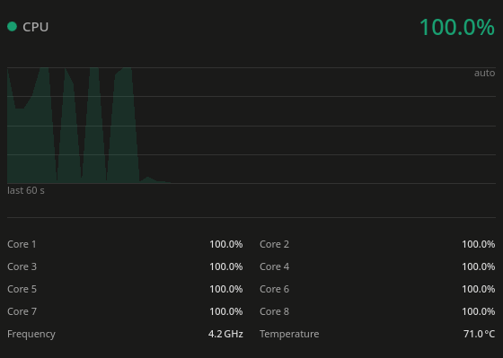
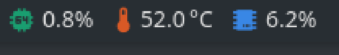

# System Graph Gauge for KDE Plasma

A KDE Plasma 6 panel widget that shows a system sensor as a plain number in the panel, and
opens a **live history graph plus a per-sensor breakdown** when you click it. Built to monitor
CPU, temperature and memory, but it works with any
[KSystemStats](https://invent.kde.org/plasma/libksysguard) sensor.





## Why

Plasma's stock *System Monitor* applet shares one "face" between the panel and the popup, so you
can't have a compact number in the panel **and** a rich graph on click — you get one or the other.
This widget separates the two: a small value in the panel, a full graph and breakdown in the popup.

## What it shows

- **Panel:** an accent-coloured icon and the sensor's current value, scaled to the panel height so
  it stays crisp at any resolution.
- **Hover:** the sensor name and value.
- **Click:** a popup with
  - a header (accent dot, title, large value),
  - a **60-sample history line chart** (fixed or auto-scaled), and
  - a **breakdown** of related sensors, with optional mini-bars (e.g. per-core CPU usage).

## Install

```sh
git clone https://github.com/OmarAlzand/sysgraph-plasmoid.git
cd sysgraph-plasmoid
kpackagetool6 --type Plasma/Applet --install .
```

Then right-click your panel → *Add or Manage Widgets…* and add **System Graph Gauge**.

To update after a `git pull`: `kpackagetool6 --type Plasma/Applet --upgrade .`
To remove: `kpackagetool6 --type Plasma/Applet --remove io.github.omaralzand.sysgraph`

## Requirements

- KDE Plasma 6
- `ksystemstats` / libksysguard sensors (part of a standard Plasma install)

## Configure

Right-click → *Configure System Graph Gauge…*:

| Setting | Meaning |
|---|---|
| **Title** | Shown in the popup header |
| **Panel glyph** | Optional icon character for the panel (e.g. a Nerd Font glyph) |
| **Main sensor id** | The sensor shown in the panel and drawn as the chart line, e.g. `cpu/all/usage` |
| **Accent colour** | Hex colour for the icon, value and chart, e.g. `#199e70` |
| **Chart maximum** | Fixed y-axis maximum (used when auto-scale is off) |
| **Auto-scale chart** | Fit the y-axis to the recent range instead of a fixed maximum |
| **Breakdown** | One sensor per line as `sensorId|Label|bar` — `bar=1` draws a mini-bar |

List the sensor ids available on your machine with:

```sh
dbus-send --session --print-reply=literal \
  --dest=org.kde.ksystemstats1 /org/kde/ksystemstats1 \
  org.kde.ksystemstats1.allSensors
```

### Example: a CPU gauge

| Setting | Value |
|---|---|
| Main sensor id | `cpu/all/usage` |
| Accent colour | `#199e70` |
| Chart maximum | `100` |
| Breakdown | `cpu/cpu0/usage|Core 1|1` … `cpu/cpu7/usage|Core 8|1`, `cpu/all/averageFrequency|Frequency|0`, `cpu/all/maximumTemperature|Temp|0` |

You can add several instances of the widget, each pointed at a different sensor.

## License

GPL-3.0-or-later. See [LICENSE](LICENSE).
